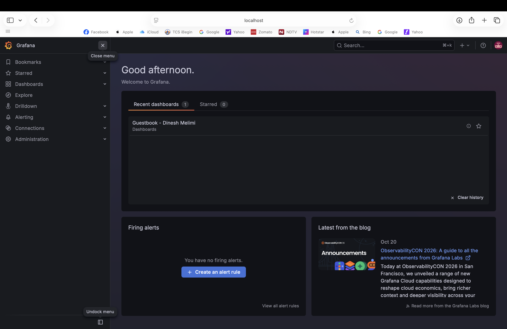
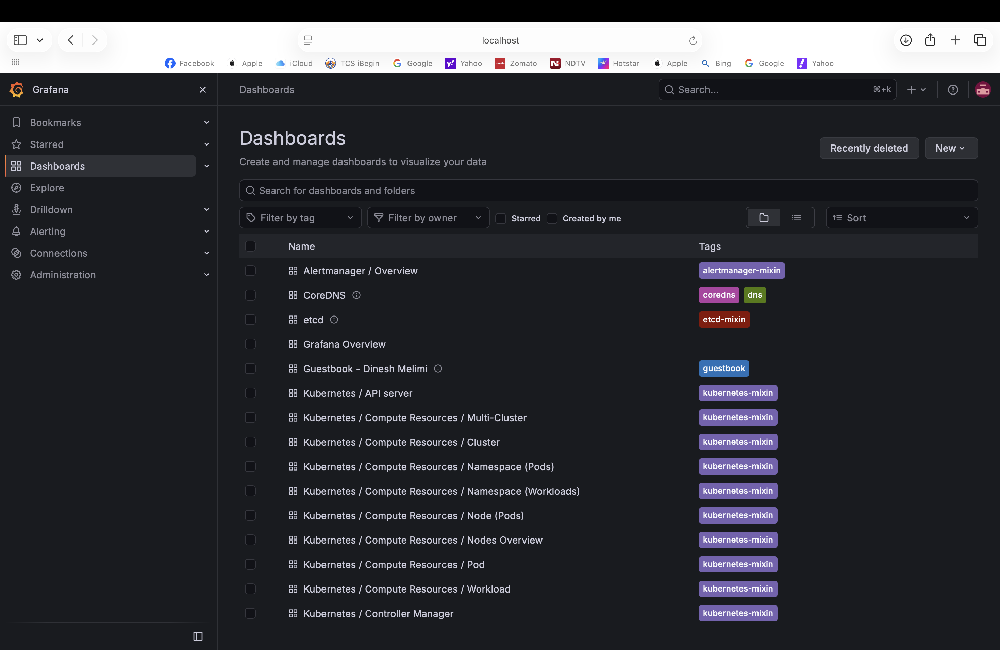
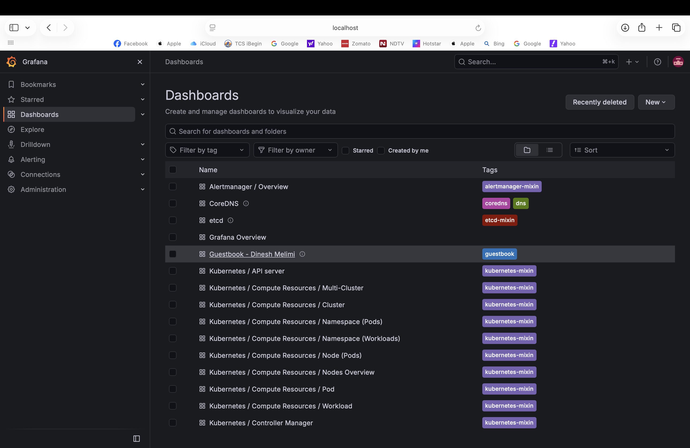
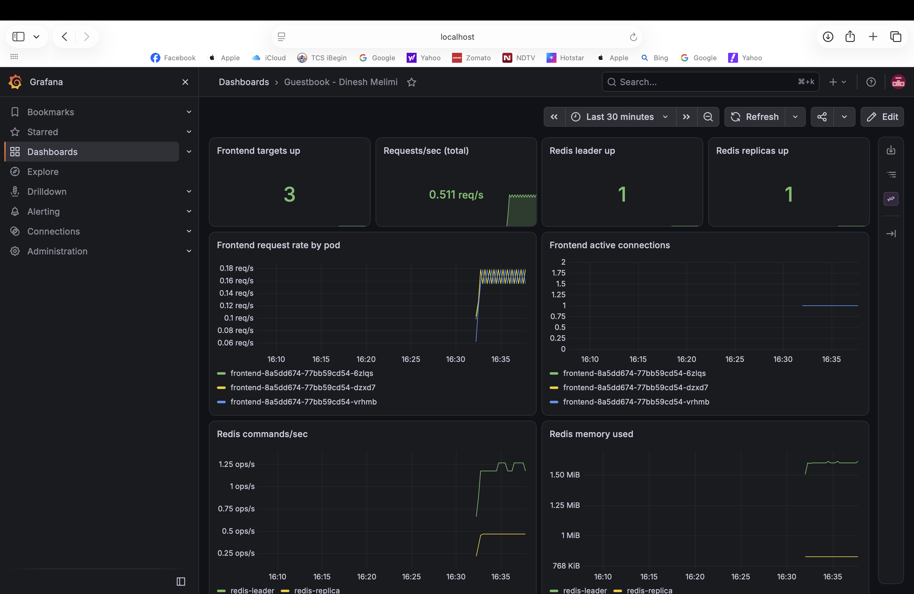
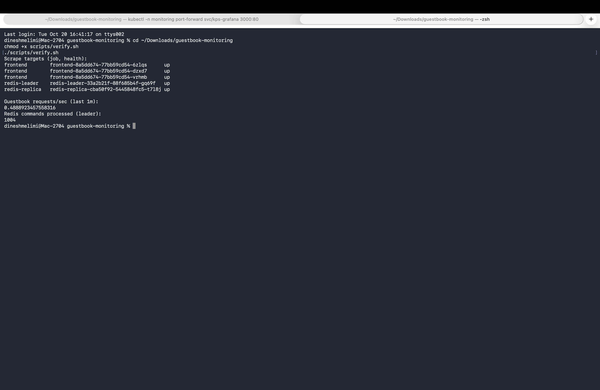

# Guestbook Monitoring with Prometheus and Grafana

**Author:** Dinesh Melimi · [github.com/Dinesh-Melimi](https://github.com/Dinesh-Melimi) · [linkedin.com/in/dinesh-melimi](https://www.linkedin.com/in/dinesh-melimi)

This extends the Pulumi Kubernetes Guestbook example ([`kubernetes-ts-guestbook/simple`](https://github.com/pulumi/examples/tree/master/kubernetes-ts-guestbook/simple)) with monitoring. One `pulumi up` deploys:

- **The Guestbook**: PHP frontend (3 replicas), Redis leader and Redis replica
- **kube-prometheus-stack** (Helm chart 92.10.1): Prometheus Operator, Prometheus, Grafana, Alertmanager, kube-state-metrics, node-exporter
- **Metrics for the app**:
  - Frontend: an nginx sidecar in front of Apache, with `nginx-prometheus-exporter` for request counts and connections
  - Redis leader and replica: `redis_exporter` sidecars for commands/sec, memory, clients and up/down state
  - Pod CPU and memory: cAdvisor and kube-state-metrics (included in the stack)
- **ServiceMonitors** for the three Guestbook services, so Prometheus scrapes them every 15s
- **Grafana** exposed as a `NodePort` (local clusters) or `LoadBalancer` (cloud)
- **A Guestbook dashboard** loaded automatically (stretch goal)
- **Alert rules** (`PrometheusRule`) for frontend down, Redis down and high frontend CPU

## Architecture

```
                 ┌──────────────── frontend pod (x3) ────────────────┐
user ──:80──▶ Service ──▶ nginx :8080 ──▶ apache/php :80              │
                 │        nginx :8081/stub_status ◀── nginx-exporter :9113 ◀──┐
                 └────────────────────────────────────────────────────┘      │
redis-leader pod:  redis :6379 ◀── redis_exporter :9121 ◀─────────────────────┤ ServiceMonitors
redis-replica pod: redis :6379 ◀── redis_exporter :9121 ◀─────────────────────┤ (scrape every 15s)
                                                                              │
                        Prometheus (monitoring ns) ───────────────────────────┘
                              │
                           Grafana  ──▶ NodePort 30300 / LoadBalancer
```

The stock `pulumi/guestbook-php-redis` image has no metrics endpoint. Instead of changing the app image, an nginx sidecar sits in front of Apache in the same pod, and its `stub_status` is turned into Prometheus metrics. Traffic is otherwise unchanged.

## Prerequisites

- [Pulumi CLI](https://www.pulumi.com/docs/install/) (tested with v3.228)
- Node.js 18+ and npm
- A Kubernetes cluster and `kubectl` context: Docker Desktop Kubernetes, minikube, kind or a cloud cluster
- `jq` (only for `scripts/verify.sh`)

## Deploy

```bash
npm install
pulumi login --local            # or your Pulumi Cloud account
pulumi stack init dev

# Local cluster (Docker Desktop / minikube / kind): ClusterIP app + NodePort Grafana
pulumi config set isMinikube true
# Cloud cluster with load balancers (EKS / AKS / GKE): LoadBalancer services
# pulumi config set isMinikube false

pulumi up
```

The first run takes 2-4 minutes while the Helm chart installs the operator and CRDs.

> **kind users:** to reach the NodePort from your machine, create the cluster with a port mapping for `30300`, or just use the port-forward below.

## Grafana access URL and admin credentials

```bash
pulumi stack output grafanaUrl
pulumi stack output grafanaAdminUsername                    # admin
pulumi stack output grafanaAdminPasswordSecret --show-secrets
```

- **Local clusters:** `http://localhost:30300` (Docker Desktop exposes NodePorts on localhost). On minikube, run `minikube service grafana-external -n monitoring --url`.
- **Cloud clusters:** `grafanaUrl` is the load balancer address (`http://<external-ip>`).
- **Any cluster:** `kubectl -n monitoring port-forward svc/kps-grafana 3000:80`, then open `http://localhost:3000`.

The username is `admin`. The password is **generated at deploy time** (`@pulumi/random`), kept encrypted in Pulumi state and printed only with `--show-secrets`. There is no hard-coded or default password.

Open **Dashboards → Guestbook - Dinesh Melimi** to see the app.

## Verify Prometheus is scraping the Guestbook

**Option 1: script**

```bash
./scripts/verify.sh
```

```
Scrape targets (job, health):
frontend        frontend-6b7c...-abcde   up
frontend        frontend-6b7c...-fghij   up
frontend        frontend-6b7c...-klmno   up
redis-leader    redis-leader-5d9...      up
redis-replica   redis-replica-7f8...     up
```

**Option 2: Prometheus UI**

```bash
kubectl -n monitoring port-forward svc/kps-kube-prometheus-stack-prometheus 9090:9090
```

1. Open `http://localhost:9090/targets` and find `serviceMonitor/default/guestbook-frontend/0`, `guestbook-redis-leader/0` and `guestbook-redis-replica/0`. Every endpoint should be **UP**.
2. Run these queries in the Graph tab:

| What | Query |
|---|---|
| Frontend requests/sec | `sum(rate(nginx_http_requests_total{job="frontend"}[1m]))` |
| Active connections per pod | `sum by (pod) (nginx_connections_active{job="frontend"})` |
| Redis commands/sec | `sum by (job) (rate(redis_commands_processed_total[1m]))` |
| Redis up | `redis_up` |
| Pod CPU | `sum by (pod) (rate(container_cpu_usage_seconds_total{namespace="default",container!=""}[5m]))` |

**Generate some traffic** so the request graphs move:

```bash
kubectl port-forward svc/frontend 8080:80 &
for i in $(seq 1 200); do curl -s http://localhost:8080/ > /dev/null; done
```

Adding entries in the Guestbook UI also writes to Redis, which shows up in Redis commands/sec.

## Grafana dashboard

`dashboards/guestbook.json` is stored in a ConfigMap labelled `grafana_dashboard: "1"`, which Grafana's sidecar loads automatically. Panels:

- Frontend targets up, total requests/sec, Redis leader and replica up (stat panels)
- Frontend request rate and active connections per pod
- Redis commands/sec and memory used
- Pod CPU and memory (working set)
- Scrape failures (any target down)

## Alerts

`guestbook-alerts` (`PrometheusRule`) adds:

| Alert | Fires when |
|---|---|
| `GuestbookFrontendDown` | no frontend pod scraped for 2 minutes |
| `GuestbookRedisDown` | leader or replica reports `redis_up == 0` for 2 minutes |
| `GuestbookFrontendHighCPU` | a frontend pod uses over 80% of its CPU request for 10 minutes |

They show under `http://localhost:9090/alerts` and are routed to Alertmanager.

## Design notes

- **Sidecar exporters instead of app changes.** The guestbook images are reused unchanged; metrics come from nginx and Redis exporters in the same pods.
- **Error rates.** nginx `stub_status` gives request and connection counts, not status codes. For 4xx/5xx rates, the next step is to switch the sidecar to an nginx build with the VTS module or parse access logs with `mtail`; the dashboard and alerts are laid out so an error-rate panel slots in.
- **Selectors.** `serviceMonitorSelectorNilUsesHelmValues: false` lets Prometheus pick up ServiceMonitors outside the chart, so the app's monitors live next to the app in `default`.
- **Resource limits** are set on every sidecar so monitoring can't starve the app.

## Security notes

- The Grafana admin password is generated, stored as a Pulumi secret and never committed.
- On cloud clusters Grafana gets a public LoadBalancer for this exercise. For real use, put it behind an ingress with TLS and SSO, or keep it ClusterIP and use port-forward.
- nginx `stub_status` only answers `127.0.0.1`, so request metrics are reachable by the exporter in the pod, not from outside.
- Exporter and nginx images are pinned to versions rather than `latest`.

## Clean up

```bash
pulumi destroy
pulumi stack rm dev
```

## Files

```
index.ts                  Pulumi program: guestbook, exporters, monitoring stack, ServiceMonitors, alerts, outputs
dashboards/guestbook.json Grafana dashboard
scripts/verify.sh         Checks Prometheus targets and sample queries
Pulumi.yaml, package.json, tsconfig.json
```

— Dinesh Melimi

## Screenshots

Running on Docker Desktop Kubernetes.

**Grafana: Guestbook dashboard**






**`scripts/verify.sh`: all Guestbook targets up**


